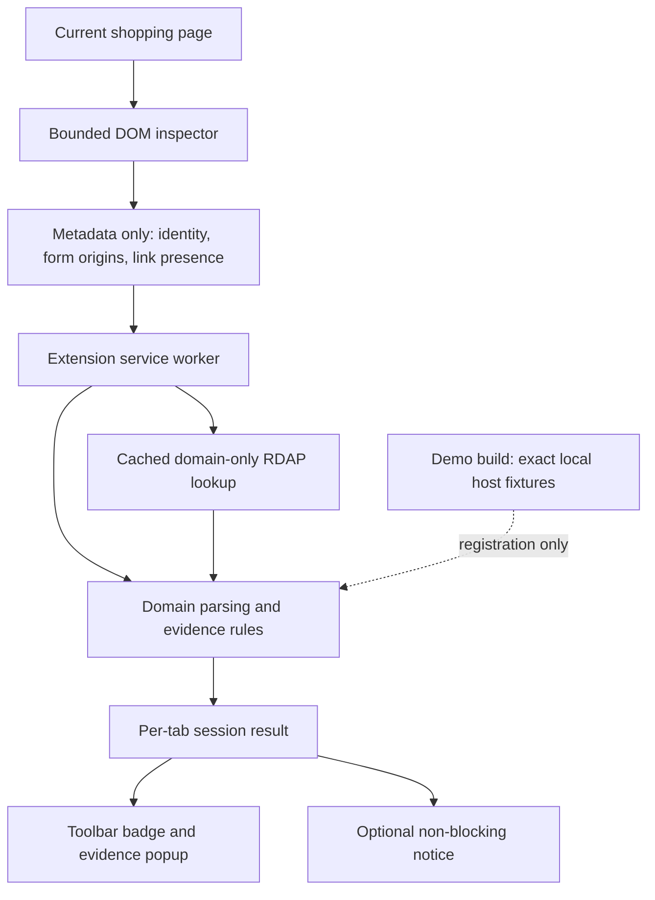

# Design and architecture

The system intentionally separates observation, decisions and presentation. The same pure engine and evidence renderer power the browser popup and labelled demo preview.

## Observations and decisions

Seven categories are evaluated in domain-to-transaction order. They are not seven independent votes. Domain complexity, brand spelling and misleading subdomains belong to the same identity evidence family. They cannot accumulate into a multi-signal verdict by repetition.

Critical transport failures justify High Risk as an unsafe interaction, without claiming the operator is a criminal. Other High Risk verdicts require a specific combination: deceptive brand identity plus very recent registration, or a deceptive hostname plus an unfamiliar sensitive form destination. Missing links, UPI and newness alone stay Review.

The user sees four verdicts and expandable evidence, without a fabricated probability. Unknown checks remain unknown even if another check triggers a warning. Results are recomputed after relevant DOM mutations and navigation. Background requests have revision guards so a late result cannot overwrite a newer page's scan.

## Runtime boundaries

- 12,000 text nodes / 60,000 public text characters per inspection.
- At most 30 forms, 60 field metadata entries per form, and 500 links.
- No input values, FormData, textarea content or editable text collection.
- Main document only; iframe and JavaScript destination limitations are disclosed.
- Mutation-triggered scans are debounced by 650 ms; unchanged facts avoid repeated work.
- RDAP has a 3.5-second network timeout, in-flight request sharing and a bounded cache.
- No remote lookup for internal hosts, reserved IPs, localhost or hosted tenant domains.
- Real and demonstration builds have separate manifests and bundles. Synthetic fixtures are tree-shaken from the live bundle.

## Visual identity

Rajdhani is bundled in medium and semibold weights for the Meadow wordmark and headings. Inter is locally bundled for evidence and body text. Dark charcoal surfaces, rounded panels, generous spacing and a monochrome palette implement the user's selected direction. High Risk uses an inverted exclamation symbol, explicit text and a pause-before-payment instruction. Colour does not encode meaning. Evidence is progressively disclosed in keyboard-operable details elements.

## Novelty and related work

Chrome and SmartScreen establish the value of contextual browser warnings. Netcraft connects identity, infrastructure and transaction evidence; VirusTotal separates findings from unavailable results. Meadow borrows those established principles while keeping a small deterministic rule set that can be inspected and demonstrated locally.

The claim is an engineering and UX contribution: scoped integration, correlated-signal handling, explicit uncertainty, privacy boundaries and reproducible demonstrations. Merely reordering algorithms does not establish scientific novelty or better accuracy. No global novelty claim is made.

## Evaluation boundary

Automated rule and browser tests check implementation behaviour, including false-positive counterexamples. They do not establish real-world fraud precision or recall. A future accuracy study requires independently labelled, held-out samples, separate reporting for URL-only versus full-page coverage, no tuning on the test set, and confidence intervals. That research is outside this build's scope.
